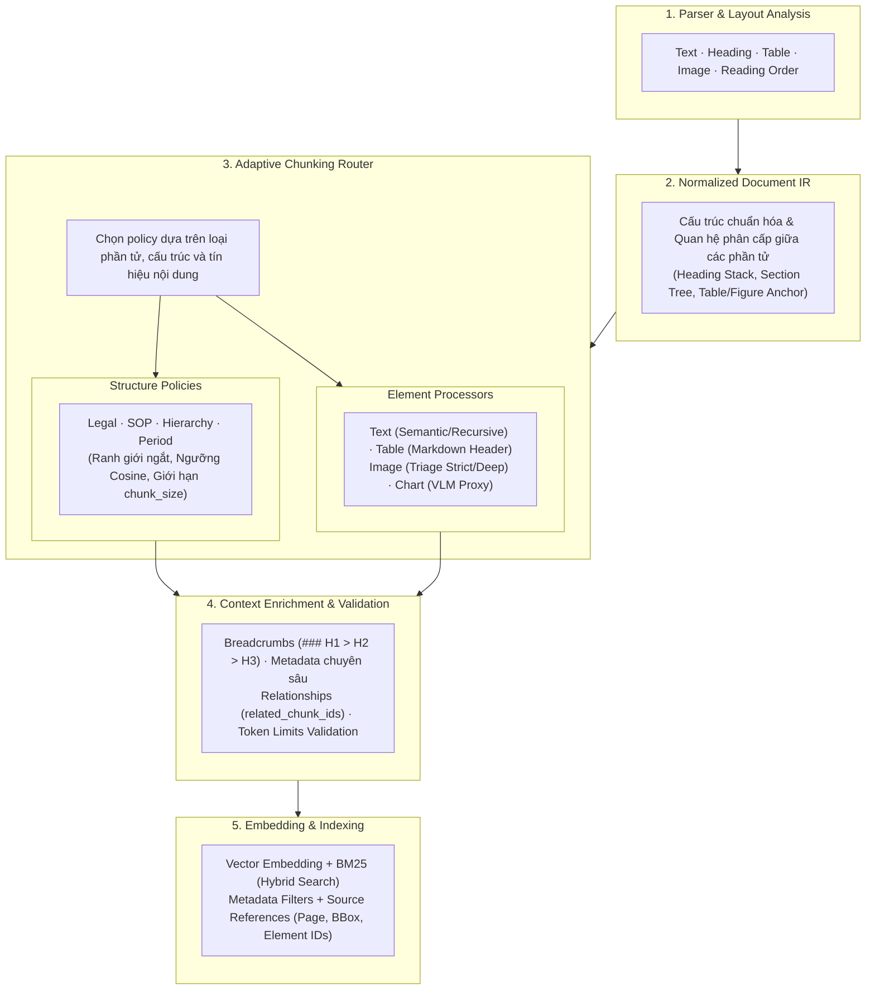

# ĐÁNH GIÁ KIẾN TRÚC & ĐỀ XUẤT CHIẾN LƯỢC CHUNKING ĐA PHƯƠNG THỨC CHO TÀI LIỆU DOANH NGHIỆP
> **Tài liệu phục vụ Architectural Review & Design Decisions**  
> **Dự án**: RAG Document Pipeline (`rag_document_pipeline`)  
> **Ngày lập**: 17/10/2026  
> **Trạng thái**: Hoàn thiện - Sẵn sàng Review

---

## Executive Summary (Tóm Tắt Dành Cho Lãnh Đạo Kỹ Thuật)

Trong hệ thống RAG doanh nghiệp, chất lượng câu trả lời của LLM phụ thuộc trực tiếp vào **độ toàn vẹn ngữ cảnh (Context Integrity)** của từng chunk. Tài liệu doanh nghiệp không thuần túy là văn bản phẳng, mà là sự pha trộn phức tạp giữa **Văn bản phân cấp**, **Bảng số liệu tài chính**, và **Hình ảnh/Sơ đồ quy trình**.

Tài liệu này tổng hợp toàn bộ quá trình phân tích, phản biện kiến trúc và đề xuất kỹ thuật cho bài toán Chunking với các kết luận cốt lõi:
1. **Loại bỏ Hardcode Regex**: Thay thế toàn bộ các biểu thức chính quy cứng nhắc khóa theo ngôn ngữ bằng cơ chế động **Layout Hierarchy (từ Parser)** kết hợp **Universal Numbering Heuristics** đa ngôn ngữ.
2. **Từ chối Over-Engineering (Không tách 5 class độc lập)**: Văn bản thực tế là **hỗn hợp (mixed)** và **phi chuẩn (non-standard)**. Việc tạo 5 class chunker riêng biệt sẽ gây trùng lặp 80% code, giòn (brittle) và dễ gãy vỡ.
3. **Chuẩn hóa thành Kiến trúc Hợp nhất (Gold Standard)**: Áp dụng **Hierarchy-Aware (Bám cấu trúc phân cấp) + Selective Semantic Chunking (Ngắt chuyển ý có chọn lọc)** làm khung băm chung cho toàn bộ hệ thống, kết hợp cơ chế bóc tách siêu dữ liệu thụ động (**Opportunistic Metadata Enrichment**) và suy thoái an toàn 4 tầng (**Graceful Degradation**).

---

## 1. Phân Tích 5 Loại Tài Liệu Doanh Nghiệp & Thách Thức Trong RAG

| Loại tài liệu | Đặc điểm nội dung | Thách thức lớn nhất trong RAG | Hậu quả nếu băm sai |
| :--- | :--- | :--- | :--- |
| **1. Hợp đồng / Điều khoản (`LEGAL_POLICY`)** | Cấu trúc phân cấp nghiêm ngặt (Chương, Điều, Khoản, Điểm). Có nhiều mệnh đề ngoại lệ và dẫn chiếu chéo. | Đơn vị quy phạm là trọn vẹn một Điều luật. Mệnh đề ngoại lệ (*"Trừ trường hợp..."*) thường nằm ở cuối. | Cắt đôi Điều luật làm mất điều kiện miễn trừ $\rightarrow$ LLM tư vấn sai hợp đồng, rủi ro pháp lý nghiêm trọng. |
| **2. Hướng dẫn / Quy trình (`GUIDE_SOP`)** | Chuỗi thao tác tuần tự (Bước 1, Bước 2...), có khối Cảnh báo/Lưu ý và ảnh chụp màn hình UI. | Tính phụ thuộc nhân quả giữa các bước. Khối cảnh báo an toàn bị tách rời khỏi bước thao tác. | LLM hướng dẫn người dùng làm thiếu bước hoặc bỏ qua cảnh báo nguy hiểm $\rightarrow$ Lỗi vận hành hệ thống. |
| **3. Báo cáo tiến độ / KPI (`PROGRESS_REPORT`)** | Bảng số liệu tiến độ, biểu đồ Gantt/Burndown, tỷ lệ hoàn thành (%), kỳ hạn báo cáo (Q1, Q2...). | Số liệu KPI bị tách rời khỏi nhãn thời gian / kỳ hạn báo cáo tương ứng. | Người dùng hỏi Q3 nhưng RAG trả lời số liệu Q2 $\rightarrow$ Ảo giác (Hallucination) về tiến độ dự án. |
| **4. Kế hoạch kinh doanh (`BUSINESS_PLAN`)** | Dự phóng tài chính nhiều năm, kịch bản kinh doanh (Base/Best/Worst case), giả định vĩ mô. | Bảng số liệu dự phóng bị tách rời khỏi phần diễn giải các Giả định (Assumptions: lãi suất, lạm phát). | Số liệu doanh thu/chi phí trở nên vô nghĩa hoặc bị hiểu sai kịch bản áp dụng. |
| **5. Sổ tay nội bộ / Wiki (`INTERNAL_WIKI`)** | Cấu trúc đề mục phân nhánh sâu (H1 $\rightarrow$ H2 $\rightarrow$ H3), chuyển đổi chủ đề nhanh giữa các đoạn. | Không có từ khóa quy chuẩn như văn bản luật; ranh giới chuyển ý mềm mại giữa các đoạn văn. | Chunk quá dài gây loãng thông tin, hoặc cắt ngang một luồng giải thích chính sách nội bộ. |

---

## 2. Vấn Đề Regex Hardcode & Giải Pháp Động Hóa

### 2.1. Hạn chế của việc Hardcode Regex mặc định
Ban đầu, các hệ thống thường tiếp cận bằng cách định nghĩa các regex danh sách từ khóa cố định:
```python
# HẠN CHẾ: Rất giòn, khóa chặt vào tiếng Việt/Anh, không nhận diện được định dạng lạ
DEFAULT_CHAPTER_PATTERN = re.compile(r"^(?:chương|phần|mục|chapter|part)\s+([ivxlcdm\d]+)...")
DEFAULT_ARTICLE_PATTERN = re.compile(r"^((?:điều|article|section)\s*[ivxlcdm\d]+)...")
DEFAULT_CLAUSE_PATTERN  = re.compile(r"((?:khoản\s*\d+|clause\s*\d+|\(\d+\)|\d+\.)...)")
```

**Nhược điểm chí mạng**:
1. **Thiếu linh hoạt ngôn ngữ**: Không thể xử lý văn bản song ngữ, tiếng Pháp, Đức, Nhật hoặc các quy chuẩn viết tắt của doanh nghiệp (`Điều`, `Đ.`, `Art.`, `Sec.`, `Quy tắc`, `Rule`).
2. **Xung đột cờ Regex trong Python 3.11+**: Lồng ghép inline `(?i)` trong chuỗi regex con dẫn đến lỗi nghiêm trọng `re.PatternError: global flags not at the start of the expression`.
3. **Phụ thuộc vào từ ngữ thay vì cấu trúc**: Một văn bản định dạng chuẩn bằng thẻ `Heading 2`, `Heading 3` của Word/PDF lại bị bỏ qua chỉ vì tác giả không đặt chữ "Điều" ở đầu dòng.

### 2.2. Giải pháp đã hiện thực hóa: Layout Hierarchy + Universal Numbering Heuristics
Trong module [`legal.py`](file:///c:/Users/ndquynh/Documents/RAG/packages/rag-document-pipeline/src/rag_document_pipeline/chunking/strategies/legal.py), hệ thống đã chuyển dịch hoàn toàn sang:

```mermaid
flowchart LR
    Node[Layout Element] --> CheckHeading{Parser có gắn<br/>heading_level?}
    
    CheckHeading -- Có --> HLevel[H1: Tiêu đề tài liệu<br/>H2: Phân chia lớn/Chương<br/>H3+: Điều/Đơn vị chính]
    CheckHeading -- Không/Text --> Numbering[Universal Numbering Heuristics]
    
    Numbering --> Dec[Thập phân phân cấp: 1.1, 1.2.3]
    Numbering --> Rom[Số La Mã: I., II., III.]
    Numbering --> Gen[Cú pháp mở: <Đơn vị> <Mã số>]
    Numbering --> Pt[Danh sách mẫu tự: a), b), (i)]
    
    HLevel --> Classified[Phân loại: chapter / article / clause / point / body]
    Dec --> Classified
    Rom --> Classified
    Gen --> Classified
    Pt --> Classified
```

* **Ưu tiên cấu trúc từ Parser (`classify_layout_node`)**: Dựa trên `heading_level`, `section_path`, và `list_item` do parser layout phân tích được.
* **Quy ước đánh số tổng quát (Universal Numbering)**:
  * `DECIMAL_HIERARCHY_PATTERN`: Tự động nhận diện `1.1` là Điều khoản, `1.1.1` là Khoản con.
  * `ROMAN_NUMERAL_PATTERN`: Tự động nhận diện `I.`, `II.` là Phân chương.
  * `GENERIC_NAMED_UNIT_PATTERN`: Nhận diện mọi cú pháp mở `<Tên bất kỳ> <Mã số>` (ví dụ: `Điều 5`, `Section 12`, `Rule 4`, `Quy chế 2`, `Chương II`).
* **Khả năng mở rộng qua `LegalHierarchyConfig`**: Cho phép ghi đè regex hoặc thêm danh sách từ khóa tùy ý (`custom_condition_keywords`, `custom_cross_ref_patterns`) mà không phải sửa code gốc.

---

## 3. Phản Biện Kiến Trúc: Có Nên Triển Khai Độc Lập Cả 5 Chiến Lược?

> **Câu hỏi kỹ thuật**: *Có nên tách riêng thành 5 class độc lập (`ProcedureAwareChunker`, `LegalHierarchyChunker`, `PeriodAwareChunker`, `ContextAwareChunker`, `StructureSemanticChunker`) không? Và có phải lúc nào văn bản thực tế cũng tuân theo các quy tắc đó không?*

### 3.1. Nhận định thực tế: Văn bản doanh nghiệp không bao giờ tuân thủ hoàn hảo
1. **Tính chất Hỗn hợp (Hybrid Documents)**:
   * Trong một tài liệu duy nhất (ví dụ: *Quy chế vận hành & Quản lý nhân sự*):
     * Trang 1-5: Chính sách tuyển dụng, kỷ luật (dạng Pháp lý: Điều, Khoản).
     * Trang 6-10: Hướng dẫn xin nghỉ phép, nộp đơn thanh toán (dạng SOP: Bước 1, Bước 2).
     * Trang 11-15: Khung đánh giá hiệu suất (dạng Báo cáo: Bảng KPI, chỉ tiêu).
   * **Nếu cố định 1 Chunker cho cả file**: 75% nội dung còn lại sẽ bị xử lý sai hoàn toàn.
2. **Hành văn phi quy chuẩn (Non-standard Formatting)**:
   * SOP không hề có chữ `"Bước 1"`, mà chỉ dùng gạch đầu dòng `-` hoặc in đậm.
   * Báo cáo tiến độ không ghi `"Kỳ báo cáo: Q3/2026"` mà chỉ ghi chú ngày tháng rải rác trong bảng.
   * Kế hoạch kinh doanh không có nhãn `"Kịch bản khả quan"` mà giải trình bằng văn xuôi.
3. **Cái bẫy Over-Engineering**:
   * Việc tạo ra 5 class độc lập sẽ gây ra **80% code trùng lặp**: cùng lặp header bảng, cùng liên kết ảnh, cùng cắt câu, cùng gắn breadcrumb.
   * Hệ thống trở nên vô cùng **giòn (brittle)**: chỉ cần tác giả đổi cách hành văn là class chuyên biệt đó chạy sai hoặc throw exception.

### 3.2. Tại sao `Hierarchy-aware` (Legal) lại cần Engine riêng?
Trong 5 loại, chỉ riêng **Văn bản pháp lý/Hợp đồng** có cấu trúc lập quy bắt buộc (Normative Structure). Cắt đứt một Điều luật làm mất câu ngoại lệ (*"Trừ trường hợp..."*) gây ra hậu quả pháp lý nghiêm trọng.

Ngược lại, 4 loại tài liệu còn lại (SOP, Báo cáo, Kế hoạch, Wiki) thực chất đều là **biến thể của tài liệu văn phòng đa phương thức (Narrative Text + Markdown Tables + Images)**.

---

## 4. Chuẩn Hóa Kiến Trúc: TẤT CẢ ĐỀU DÙNG "Hierarchy-Aware + Semantic Chunking"

> **Nguyên tắc Kiến Trúc Bất Biến**:
> Toàn bộ 5 loại tài liệu (Pháp lý, Hướng dẫn/SOP, Báo cáo KPI, Kế hoạch kinh doanh, Sổ tay/Wiki) **ĐỀU ĐƯỢC XỬ LÝ THEO CÙNG MỘT BỘ KHUNG KIẾN TRÚC 5 TẦNG HỢP NHẤT**.
>
> Thay vì tạo 5 class chunker đồ sộ gây phân mảnh mã nguồn, kiến trúc tách bạch rõ ràng giữa:
> * **Structure Policies (Chính sách cấu trúc)**: Quy định ranh giới ngắt (Legal, SOP, Hierarchy, Period) và ngưỡng chuyển ý Cosine.
> * **Element Processors (Bộ xử lý phần tử)**: Các engine chuyên trách băm Text (Semantic/Recursive), Bảng (Markdown lặp header), và Ảnh/Biểu đồ (Triage & VLM).



### Ý Nghĩa Kiến Trúc Của Từng Tầng:

1. **Tầng 1 (Parser & Layout Analysis)**:
   * Trích xuất chính xác các phần tử nguyên thủy (`LayoutElement`) bao gồm text, headings, bảng biểu, hình ảnh và luồng đọc tự nhiên (`reading order`).
2. **Tầng 2 (Normalized Document IR - Intermediate Representation)**:
   * Chuẩn hóa cấu trúc và thiết lập quan hệ cha - con: lan truyền cây phân cấp đề mục (`section_path`) từ `H1 > H2 > H3` xuống từng đoạn văn, gắn neo bảng và ảnh vào đúng section chứa nó.
3. **Tầng 3 (Adaptive Chunking Router - Trọng tâm thiết kế)**:
   * Phân tách độc lập giữa **Structure Policies** (điều khiển ranh giới ngắt và ngưỡng semantic) và **Element Processors** (bộ băm dữ liệu thuần túy).
   * Mọi văn bản tự sự dù thuộc loại tài liệu nào đều đi qua `TextProcessor` với **Semantic Chunking** được bật, chỉ khác nhau ở ngưỡng Cosine phù hợp.
4. **Tầng 4 (Context Enrichment & Validation)**:
   * Gắn nhãn breadcrumb vào đầu nội dung chunk, trích xuất metadata nghiệp vụ cơ hội (`article_id`, `step_number`, `report_period`, `scenario`), thiết lập liên kết hai chiều (`related_chunk_ids`) giữa văn bản và bảng/ảnh, kiểm định an toàn giới hạn token.
5. **Tầng 5 (Embedding & Indexing)**:
   * Đẩy chunk đã chuẩn hóa vào cơ sở dữ liệu vector kết hợp chỉ mục BM25, hỗ trợ lọc metadata chính xác tuyệt đối khi truy vấn.

---

### 4.1. Cách Vận Hành Của Cặp Đôi "Hierarchy-Aware + Semantic Chunking" Cho Từng Loại

Không có loại tài liệu nào bị tắt Semantic Chunking. Sự khác biệt duy nhất giữa các loại tài liệu là **Ngưỡng Cosine (`threshold_percentile`)** và **Kích thước tối đa (`chunk_size`)** để tối ưu hóa đặc thù ngữ nghĩa của từng loại:

1. **Văn bản Pháp lý / Hợp đồng (`LEGAL_POLICY`)**:
   * **Hierarchy**: Bám chặt đơn vị Điều (Article) và Khoản (Clause).
   * **Semantic**: **BẬT** (`threshold_percentile = 95.0%`). Ngưỡng cực cao để ngăn thuật toán ngắt rời các câu điều kiện (*"Trừ trường hợp..."*) ra khỏi mệnh đề chính; chỉ ngắt khi có sự chuyển dịch ý pháp lý dứt khoát.
2. **Tài liệu Hướng dẫn / Quy trình (`GUIDE_SOP`)**:
   * **Hierarchy**: Bám theo các đầu mục Bước thực hiện (`Bước 1`, `Bước 2`).
   * **Semantic**: **BẬT** (`threshold_percentile = 85.0%`). Khi một bước thao tác quá dài, semantic chunking tự động tìm điểm kết thúc một hành động con để tách, đảm bảo khối Lưu ý/Cảnh báo không bị vỡ.
3. **Báo cáo Tiến độ / KPI (`PROGRESS_REPORT`)**:
   * **Hierarchy**: Bám theo kỳ báo cáo (`Q3/2026`) và phòng ban phụ trách.
   * **Semantic**: **BẬT** (`threshold_percentile = 85.0%`). Tách tự nhiên giữa phần đánh giá định tính (kết quả đạt được) và phần phân tích rủi ro/tồn đọng.
4. **Kế hoạch Kinh doanh (`BUSINESS_PLAN`)**:
   * **Hierarchy**: Bám theo tiêu đề kịch bản (`Base case`, `Optimistic`) và các khối kế hoạch.
   * **Semantic**: **BẬT** (`threshold_percentile = 85.0%`). Tách rời mạch lạc giữa phần giả định vĩ mô và phần phân tích chiến lược doanh thu/chi phí.
5. **Sổ tay Nội bộ / Wiki (`INTERNAL_WIKI`)**:
   * **Hierarchy**: Bám theo cấu trúc thư mục wiki đa cấp.
   * **Semantic**: **BẬT** (`threshold_percentile = 80.0%`). Dò bắt linh hoạt các điểm chuyển ý giữa các đoạn văn tự sự.

---

### 4.2. Cơ Chế Bóc Tách Siêu Dữ Liệu "Cơ Hội" (Opportunistic Metadata Enrichment)

Hệ thống không ép buộc tài liệu phải tuân thủ định dạng. Thay vào đó, áp dụng nguyên lý: **"Bắt được thì làm giàu metadata, không bắt được thì fallback tự nhiên mà không lỗi"**:

```python
# Nguyên lý bóc tách cơ hội trong router.py
def enrich_opportunistic_metadata(chunk: DocumentChunk, text: str) -> None:
    # 1. Tín hiệu Quy trình: Nếu có "Bước 1" -> gắn metadata, không có thì thôi
    if step_m := re.search(r"(?i)\b(?:bước|step)\s*(\d+)\b", text):
        chunk.metadata["step_number"] = int(step_m.group(1))
    
    # 2. Tín hiệu Cảnh báo an toàn
    if re.search(r"(?i)\b(cảnh báo|warning|nguy hiểm|danger)\b", text):
        chunk.metadata["warning_level"] = "warning"

    # 3. Tín hiệu Kỳ báo cáo: Nếu có "Q3/2026", "Sprint 14" -> gắn metadata
    if period_m := re.search(r"(?i)\b(Q[1-4](?:/\d{4})?|Sprint\s*\d+|FY\s*\d{4})\b", text):
        chunk.metadata["report_period"] = period_m.group(1)

    # 4. Tín hiệu Kịch bản kinh doanh: Nếu có "Base case", "Kịch bản khả quan"
    if sc_m := re.search(r"(?i)\b(kịch bản cơ sở|kịch bản khả quan|base case|best case)\b", text):
        chunk.metadata["scenario"] = sc_m.group(1)
```

---

### 4.3. Cơ Chế Suy Thoái An Toàn 4 Tầng (Graceful Degradation Fallback)

Khi gặp bất kỳ văn bản nào (từ chuẩn chỉnh nhất đến phi quy chuẩn nhất), hệ thống luôn suy thoái an toàn qua 4 tầng:

```text
Tầng 1: Đơn vị quy phạm / Quy trình rõ ràng (Điều, Khoản, Bước 1, Bước 2)
   ↓ (Nếu không có định dạng đơn vị rõ ràng)
Tầng 2: Cấu trúc Layout Parser (Heading H1 > H2 > H3, Table, List Item, Figure)
   ↓ (Nếu khối văn bản trong mục vẫn vượt quá chunk_size)
Tầng 3: Chuyển dịch ngữ nghĩa Semantic (Cosine Distance Topic Shift - ÁP DỤNG TOÀN DIỆN)
   ↓ (Nếu văn bản không có điểm ngắt ngữ nghĩa rõ rệt)
Tầng 4: Phân tách đệ quy an toàn (Recursive Boundary: Dấu chấm câu '.', Xuống dòng '\n\n')
```

---

## 5. Bảng Ma Trận Cấu Hình Thực Tế (Production Profiles)

Toàn bộ hệ thống được điều phối qua **1 Router thống nhất duy nhất** ([`AdaptiveChunkingRouter`](file:///c:/Users/ndquynh/Documents/RAG/packages/rag-document-pipeline/src/rag_document_pipeline/chunking/router.py)). **TẤT CẢ các Profile đều bật Semantic Chunking (`semantic_enabled=True`)**:

| Tham số / Chiến lược | Legal / Policy | Guide / SOP | Progress / KPI | Business Plan | Internal / Wiki |
| :--- | :--- | :--- | :--- | :--- | :--- |
| **Hierarchy-Aware** | ✅ **BẬT** | ✅ **BẬT** | ✅ **BẬT** | ✅ **BẬT** | ✅ **BẬT** |
| **Semantic Chunking** | ✅ **BẬT (95.0%)** | ✅ **BẬT (85.0%)** | ✅ **BẬT (85.0%)** | ✅ **BẬT (85.0%)** | ✅ **BẬT (80.0%)** |
| **Kích thước `chunk_size`** | 2000 chars | 1500 chars | 1500 chars | 1500 chars | 1200 chars |
| **Kích thước tối thiểu** | 400 chars | 300 chars | 300 chars | 300 chars | 300 chars |
| **Chế độ lọc ảnh (Triage)**| `strict` (Bỏ dấu/ký) | `deep` (Đọc UI/Flow) | `deep` (Đọc Gantt) | `deep` (Đọc Chart) | `strict` (Bỏ icon/avatar)|
| **Lặp Header bảng** | ✅ Có | ✅ Có | ✅ Có | ✅ Có | ✅ Có |
| **Trường lọc Metadata** | `article_id`, `references`, `conditions_present` | `step_number`, `warning_level` | `report_period`, `metric_name`, `status` | `scenario`, `fiscal_period`, `currency` | `department`, `topic` |

---

## 6. Khuyến Nghị Hành Động (Actionable Recommendations)

1. **Về Mã Nguồn & Chiến Lược**:
   * **KHÔNG** chia nhỏ thành 5 class độc lập để tránh phân mảnh mã nguồn và lỗi khi văn bản không tuân thủ mẫu.
   * **ĐỒNG BỘ 100% CẤU HÌNH**: Mọi Profile trong [`router.py`](file:///c:/Users/ndquynh/Documents/RAG/packages/rag-document-pipeline/src/rag_document_pipeline/chunking/router.py) đều đặt `semantic_enabled = True` kết hợp với kế thừa cấu trúc phân cấp `propagate_sections`.
   * **BẢO VỆ ĐA PHƯƠNG THỨC**: Luôn tách Bảng (`TableChunker`) và Ảnh (`ImageChunker`) thành các chunk riêng biệt có lặp header / VLM proxy, chỉ áp dụng Semantic Chunking cho văn bản tự sự.
2. **Về Khâu Đánh Chỉ Mục (Indexing & Retrieval)**:
   * Tận dụng các trường metadata (`report_period`, `step_number`, `article_id`, `scenario`) vào **Metadata Filtering** của Vector Database kết hợp **BM25 Keyword Search** (Hybrid Search), giúp tìm chính xác tuyệt đối các câu hỏi định lượng.
3. **Về Đảm Bảo Chất Lượng (QA / Testing)**:
   * Sử dụng bộ test hiện có ([`test_adaptive_chunking.py`](file:///c:/Users/ndquynh/Documents/RAG/packages/rag-document-pipeline/tests/test_adaptive_chunking.py)) với 56 test cases đang đạt tỷ lệ pass 100% làm chuẩn mực hồi quy khi nạp thêm dữ liệu thực tế.
